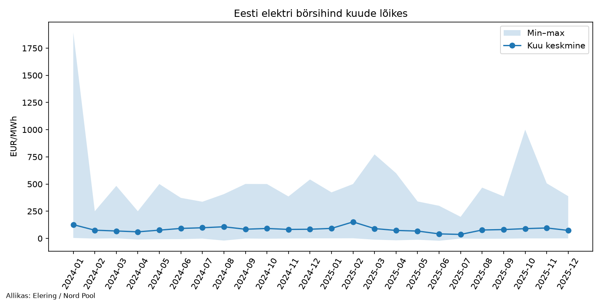
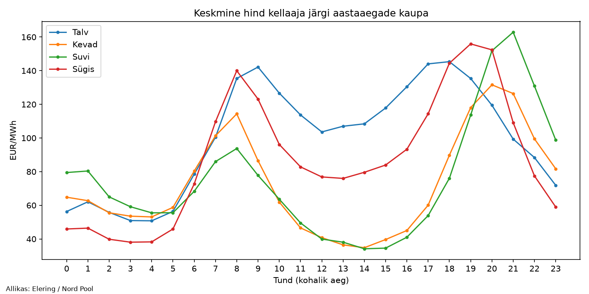
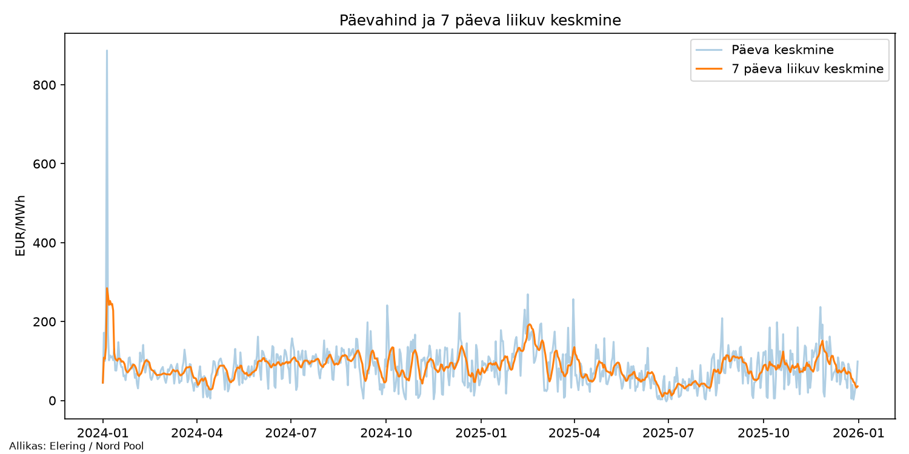

# Eesti elektri börsihinna analüüs (SQL + Python)

Eesti elektri börsihinna (Nord Pool) analüüs. Eesmärk on näidata, kuidas SQL-i ja Pythoni abil hinnaandmeid korrastada, kokku võtta ja visualiseerida ning kuidas hinna kõikumist ehk riski mõõta.

> **Märkus:** tegemist on õppeprojektiga. Järeldused põhinevad ainult hinnaandmetel ning avalikel ülevaadetel ega võta arvesse tarbimist, tootmist ega lepinguid.

## Küsimused, millele vastan

1. Millisel kuul oli keskmine börsihind kõrgeim ja mis seda mõjutas?
2. Millal päeva jooksul on elekter kõige odavam ja kõige kallim?
3. Milline kuu oli hinna poolest kõige kõikuvam (**volatiilsus** ehk standardhälve) ja mis seda põhjustas?
4. Kui sageli ja millal oli hind negatiivne?

## Andmed

### Allikad (veebilehed)

| Allikas | Veebileht | Mida sealt saab |
|---|---|---|
| Elering Dashboard API (**otsene allikas**) | https://dashboard.elering.ee/api/nps/price | Nord Pooli Eesti (`ee`) päev-ette börsihind JSON-formaadis. Skript `src/01_lae_andmed.py` pärib andmed sealt parameetritega `start` ja `end` (UTC). |
| Nord Pool (**algallikas**) | https://www.nordpoolgroup.com | Põhjamaade ja Balti riikide elektribörs, kus hind tekib. Elering vahendab selle avaliku API kaudu. |

Andmeid laetakse automaatselt, API võtit ei ole vaja. Käsitsi allalaaditud faile ei kasutata.

### Andmete kirjeldus

- **Ühik:** EUR/MWh.
- **Periood:** 2024-01-01 … 2025-12-31 (muudetav faili `src/01_lae_andmed.py` alguses).
- **Ühtlustamine:** alates 2025. aasta oktoobrist on päev-ette hind 15-minutiline, varem tunnine. Skript arvutab kõigile **tunni keskmise hinna**.
- **Ajavöönd:** kohalik aeg (Europe/Tallinn). Sügisese kellakeeramise tõttu esineb üks kellaaeg kaks korda.

## Käivitamine (Windows)

```
cd elektrihind_analuus
python -m venv .venv
.venv\Scripts\activate
pip install -r requirements.txt
python src\01_lae_andmed.py
python src\02_analuus.py
```

Esimene skript laeb andmed kausta `data/`, teine teeb SQL-päringud ja analüüsi ning salvestab tulemused kausta `results/`.

## Kausta sisu

| Fail | Sisu |
|---|---|
| `src/01_lae_andmed.py` | Laeb andmed API-st, ühtlustab tunnihinnaks, salvestab CSV |
| `sql/paringud.sql` | 7 SQL-päringut: GROUP BY, ORDER BY/LIMIT, CTE, akenfunktsioonid (`AVG OVER`, `LAG`) |
| `src/02_analuus.py` | Laeb andmed SQLite'i, jooksutab päringud, arvutab riskinäitajad pandases, joonistab graafikud |
| `data/` | Allalaaditud andmed |
| `results/` | Graafikud (PNG) ja tulemustabelid (CSV) |

## Meetodid

- **SQL (SQLite):** kuukeskmine, miinimum ja maksimum; kümme kallimat tundi; tunniprofiil (ka aastaaegade lõikes); päevade kõikumine (maksimum miinus miinimum) CTE-ga; 7 päeva liikuv keskmine; kuu muutus võrreldes eelmise kuuga (`LAG`).
- **Python (pandas):** kuu standardhälve, 95. protsentiil, negatiivsete hindadega tundide arv, variatsioonikordaja (standardhälve / keskmine).
- **Visualiseerimine (matplotlib):** kuukeskmine koos min–max vahemikuga, aastaaegade tunniprofiil, päevahind ja 7 päeva liikuv keskmine.

## Riskinäitajate arvutus

Arvutus on funktsioonis `riskinaitajad()` failis `src/02_analuus.py`.

### 1. Kuudeks jagamine

```python
kuu = df["aeg"].str[:7]          # nt "2024-03"
g = df.groupby(kuu)["hind"]      # kõik selle kuu tunnihinnad ühte rühma
```

Iga kuu on rühm tunnihindu, ligikaudu 720 väärtust (30 päeva × 24 tundi).

### 2. Näitajad iga kuu kohta

| Veerg | Arvutus | Mida see näitab |
|---|---|---|
| `keskmine` | `g.mean()` | kuu tunnihindade aritmeetiline keskmine |
| `standardhalve` | `g.std()` | kui kaugel keskmisest hinnad tavaliselt on |
| `p95` | `g.quantile(0.95)` | hind, millest 95% tundidest on odavamad |
| `negatiivseid_tunde` | tundide arv, kus hind < 0 | mitu tundi oli hind negatiivne |
| `variatsioonikordaja` | standardhälve ÷ keskmine | kõikumine keskmise suhtes |

### 3. Standardhälve

Valem: leia iga tunni hinna ja kuu keskmise vahe, tõsta ruutu, liida kokku, jaga arvuga (n − 1) ja võta ruutjuur.

Näide: kui keskmine on 80 EUR/MWh ja standardhälve 30, siis umbes kaks kolmandikku tundidest on hinnavahemikus 50…110. Mida suurem arv, seda rohkem hinnad kõiguvad ehk seda suurem on hinnarisk.

`pandas` kasutab `.std()` puhul jagajat n − 1 (valimi standardhälve), mitte n.

### 4. Variatsioonikordaja

See võimaldab võrrelda kuid, kus keskmine hind on väga erinev. Kui kuu A keskmine on 40 ja standardhälve 20 (0,50) ning kuu B keskmine on 200 ja standardhälve 40 (0,20), siis A on suhteliselt kõikuvam, kuigi B standardhälve on suurem.

## Tulemused

### Aastate võrdlus

| Näitaja | 2024 | 2025 | Muutus |
|---|---|---|---|
| Keskmine hind (EUR/MWh) | 87,27 | 80,38 | 🟢 −6,89 (−7,9%) |
| 95. protsentiil (EUR/MWh) | 194,87 | 209,21 | 🔴 +14,34 (+7,4%) |
| Negatiivseid tunde | 183 | 203 | 🟡 +20 (+10,9%) |

🟢 tarbija jaoks parem, 🔴 halvem, 🟡 sõltub vaatenurgast (madalam hind on tarbijale soodsam, aga rohkem negatiivseid tunde viitab suuremale kõikumisele).

- _**Kõige kõrgema keskmise hinnaga oli veebruar 2025**, keskmine hind 151,67 EUR/MWh. Variatsioonikordaja oli vaid 0,48 ja 95. protsentiil 284,58 EUR/MWh (perioodi kõrgeim), seega hinnad püsisid kogu kuu kõrged. Konkurentsiameti ülevaate järgi mõjutasid hinda Eesti ja Läti elektrijaamade pikaajalised hooldus- ja remonttööd, vähene tuule- ja päikeseenergia, suur nõudlus ning EstLink 2 mitte töötamine [1]._
- _**Kõige kõikuvam kuu oli jaanuar 2024**, kui tüüpiline tunnihind erines kuu keskmisest umbes 181 EUR/MWh võrra. Seda on palju, kuna Eesti tunnihinna kõikumine on tavaliselt kümnetes eurodes. Kõrge standardhälve tuleb üksikutest äärmuslikest hinnapiikidest (min 4,17 ja max 1 896,00 EUR/MWh). 95. protsentiil oli samal ajal 250,02 EUR/MWh ehk 95% tundidest oli hind sellest madalam, seega piigid olid harvad. Konkurentsiameti ülevaate järgi oli 2024. aasta jaanuari alguses äärmiselt külm, mis tõstis tarbimist Eestis ja Soomes, ja elektrijaamades toimusid hooldustööd ning EstLink 2 osaline töö [2]._
- _**Odavaim tund oli 04:00** (49,45 EUR/MWh) ja **kallim 20:00** (138,87 EUR/MWh). Päeva keskel (12:00–15:00) oli hind madalam kui hommikul ja õhtul. Öösel on tarbimine väike ja seda katavad tuuleenergia ning import Estlingi kaudu. Päeval määrab hinna ERR-i artikli põhjal viimane turule pääsenud ehk kõige kallim tootja ning hind tõuseb, kui kaabel ei tööta [3]. Aastaaegade graafiku järgi on keskpäevane hinnalangus olemas kevadel ja suvel, talvel mitte. See on kooskõlas päikeseenergia mõjuga, kuid ei tõenda seda._
- _**Negatiivseid tunde oli kokku 386 tundi** 17 544-st ehk umbes 2,2%. Kõige rohkem oli negatiivseid tunde juunis 2025: 68 tundi, ja sama kuu miinimum oli −21,71 EUR/MWh. Samal ajal oli 2025. aasta juuni ja juuli kõige madalama keskmisega (41,48 ja 36,63 EUR/MWh). Negatiivseid tunde oli kevadest suveni rohkem ja talvel peaaegu üldse mitte (2024. aasta jaanuaris, detsembris ning 2025. aasta jaanuaris ja veebruaris 0). Võimalik põhjus on suur päikese- või tuuleenergia tootmine. 2024. aastal oli negatiivseid tunde 183, mis kattub ERR-i andmetega [4]. Baltic Energy Partnersi juhatuse liige Marko Allikson toob artiklis välja, et negatiivsete hindade põhjus on liigne juhitamatu taastuvenergia [4]._

### Viited

[1] Konkurentsiamet. Energiaturgude ülevaade, veebruar 2025. https://www.konkurentsiamet.ee/sites/default/files/documents/2025-04/Energiaturgude%20%C3%BClevaade%20veebruar%202025.pdf

[2] Konkurentsiamet. Energiaturgude ülevaade, jaanuar 2024. https://www.konkurentsiamet.ee/sites/default/files/documents/2024-03/Energiaturgude%20%C3%BClevaade%20jaanuar%202024.pdf

[3] ERR (14.01.2025). Soe ja tuulerohke talv toob elektrihinna öösel ja päeval suure erinevuse. https://www.err.ee/1609575937/soe-ja-tuulerohke-talv-toob-elektrihinda-oosel-ja-paeval-suure-erinevuse

[4] ERR (20.03.2025). Tulevikus näeb negatiivseid ja nullilähedasi elektrihindu harvem. https://www.err.ee/1609637380/tulevikus-naeb-negatiivseid-ja-nullilahedasi-elektrihindu-harvem





## Piirangud

- Ainult börsihind. Lõpphind tarbijale sisaldab ka võrgutasu, makse ja marginaali.
- Keskmised peidavad üksikuid äärmuslikke tunde. Seepärast on kõrval standardhälve ja 95. protsentiil.
- Standardhälve ei ole ametlik riskimõõdik nagu VaR. See on lihtne volatiilsuse näitaja.
- See on hinna taseme hajuvus, mitte hinnamuutuste (tootluse) volatiilsus, nagu seda finantsmaailmas tihti mõõdetakse.
- Osa kõikumisest tuleb päevasest rütmist: öösel on elekter odavam ja õhtul kallim. See tõstab standardhälvet ka siis, kui hind ei ole „riskantne".
- Ekstreemsed tunnid mõjutavad ruutu võtmise tõttu standardhälvet tugevalt. Seepärast on kõrval p95.

## Analüüsi võimalikud edasiarendused

- Lisada teised Balti riigid ja Soome ning võrrelda hindu.
- Selgitada hinna kõikumist tarbimise või tuule andmetega.
- Arvutada lihtne ajalooline VaR (näiteks 95% päevane).
- Tulemustest Power BI aruanne.
